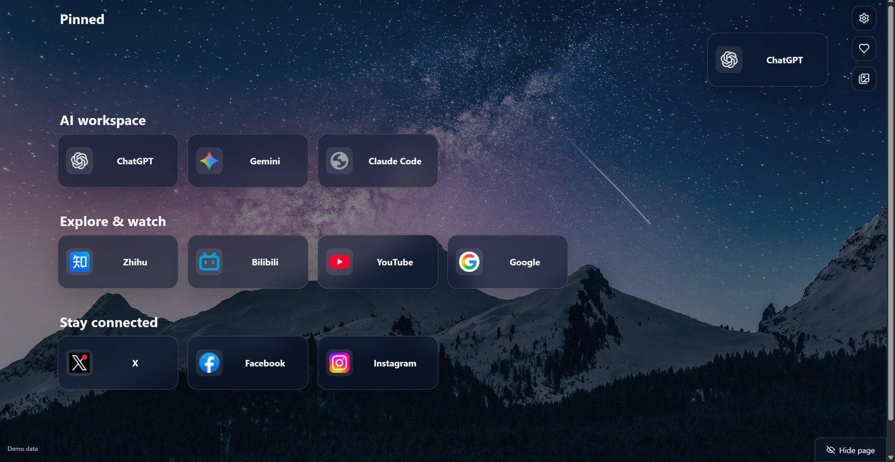
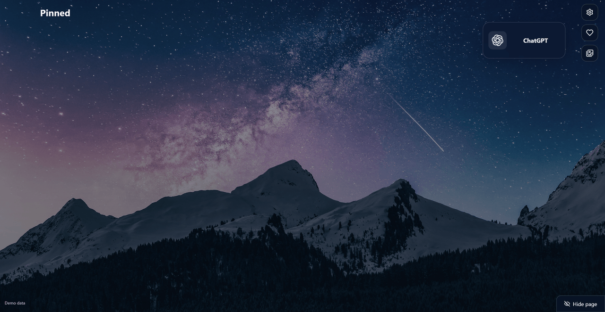

# Prelude

[简体中文](README.zh-CN.md) · [Feature tour](https://zzy2670.github.io/Prelude/) · [Chrome and Edge packages](https://github.com/zzy2670/Prelude/releases/latest)

Prelude turns webpages into cards on your new-tab page. Arrange them in six-column groups, keep useful links pinned at the top, and save the wallpapers shown on the page.



## Add a page while it is open

Move the pointer to the top of the page to reveal copies of the tabs in your current window. Drag a copy into a group or an empty card position. Links from the bookmarks bar keep their saved names and browser icons.

## Put groups and cards where you want them

Each row has six positions. Drag a card into an empty position to place it there; gaps stay where you leave them. Drop a page between groups or in the space below them to create a group. Drag a group heading to change its order.

Double-click a title to edit it. Left-click a card to open it in the current tab, or middle-click to open it in the background. Use the button beside a group heading to open that group's pages together.

Pin a card to the fixed top group. Unpin it to return it to its original group. Card and group changes support multiple undo and redo steps with **Ctrl+Z** and **Ctrl+Y**.

Desktop `.url` shortcuts can also be dragged in as regular web cards.

## Switch to a second page

Hover at the bottom right and click **Hide page** to switch to a separate second page; click again to return. The second page starts empty. Each page saves its own cards and groups, while wallpapers and settings are shared. Refreshing or opening a new tab starts on the original page.

## Keep the wallpapers you like

Wallpapers change every minute by default. Set your own interval in minutes, adjust the background brightness and card opacity, or change the wallpaper immediately.



This preview changes every three seconds. The extension uses the interval you choose.

Save the current image with the heart button; click again to unsave it. The wallpaper album opens on the page, with three columns of thumbnails in their original proportions. Open an image’s original URL, download it or remove it. Download the whole collection to your chosen folder.

## Example groups

- **Search and reading:** Google, Zhihu.
- **Video:** Bilibili, YouTube.
- **Social:** X, Facebook, Instagram.
- **AI tools:** Gemini, ChatGPT, Claude Code.

## Install in Chrome or Edge

1. Open [Releases](https://github.com/zzy2670/Prelude/releases/latest) and download the ZIP for your browser. Extract it into a permanent folder.
2. In Chrome, open `chrome://extensions/`. In Edge, open `edge://extensions/`. Enable **Developer mode**.
3. Choose **Load unpacked** and select the extracted folder containing `manifest.json`.
4. Open a new tab. Keep the extracted folder after installation.

Choose English or Simplified Chinese in Settings. Chrome and Edge keep their cards, preferences and wallpaper collections in their own browser profiles.

### Ask an AI to install it

With an AI agent that has local Windows PowerShell and UI Automation access, send:

> Deploy https://github.com/zzy2670/Prelude in my existing Chrome profile. Follow the repository's AGENTS.md, prepare the official package, complete the browser installation, and verify a real new tab.

The public [deployment skill](.agents/skills/deploy-prelude/SKILL.md) covers package verification, a permanent extension directory, installation and reload. Add “in Edge” or “in both Chrome and Edge” to choose those targets. Complete operating-system permission prompts yourself when requested.

## Data and permissions

Cards, groups, preferences and saved images are stored locally in the browser profile. The tabs permission provides the current-window tab copies; bookmarks and favicon access supply saved names and icons. Download access saves the images you select. A default folder is chosen through the browser's folder picker.

Backgrounds come from the Bonjourr Daylight collection on Unsplash.

## Development

```bash
npm ci --ignore-scripts
npm test
npm run build
node scripts/package-extensions.mjs
```

Load `dist` as the unpacked extension. The packaging script requires Python 3 and creates Chrome and Edge ZIP files with installation instructions, the license and SHA-256 checksums in `release`.

## License

[MIT](LICENSE).
