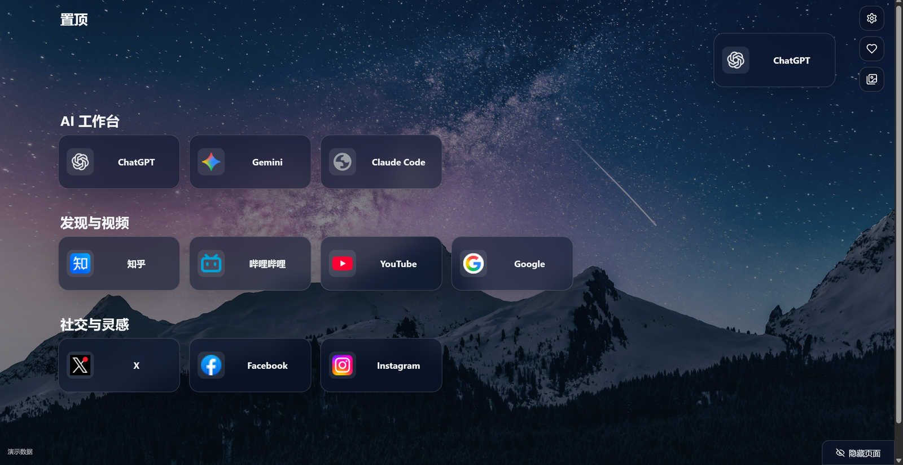
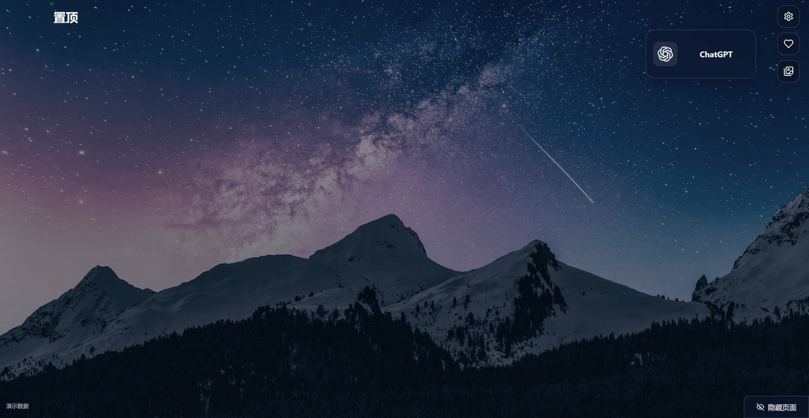

# 序页

[English](README.md) · [图文介绍](https://zzy2670.github.io/Prelude/) · [Chrome / Edge 安装包](https://github.com/zzy2670/Prelude/releases/latest)

序页把网页做成新标签页里的卡片。每行六个位置，按自己的用途分组，把常用链接置顶，也能收藏当前壁纸。



## 正在看的网页，直接拖进来

鼠标移到页面顶部，会出现当前窗口的标签页副本。把副本拖到下方分组或空位，就能留下这张网页卡片。从书签栏拖入时，沿用收藏夹里的名称和浏览器图标。

## 分组和卡片，放在自己选的位置

每行固定六个位置，空位会保留。把网页拖到两个分组之间，或页面最下方的空白处，就会创建分组；拖动组名可以调整前后顺序。

双击标题修改名字。左键在当前标签打开，中键在后台打开新标签；组名旁的按钮可以一键打开该组网页。

常用卡片可以移到顶部固定的“置顶”组，取消置顶后回到原分组。卡片和分组操作支持多次撤销、重做，快捷键是 **Ctrl+Z** 和 **Ctrl+Y**。

桌面的 `.url` 网页快捷方式也可以直接拖成网页卡片。

## 需要时，切到第二页

鼠标移到右下角，点击“隐藏页面”切到独立的第二页，再点一次回到原页。第二页初始为空，两页分别保存卡片和分组，共用壁纸与设置。刷新或打开新标签页时，默认显示原页。

## 喜欢的壁纸，留进相册

壁纸默认每分钟更换一次。设置中可以输入自己的分钟间隔，调整背景亮度、卡片不透明度，也可以立即换图。



动图每 3 秒换一张，插件按你设置的间隔换图。

点击爱心收藏当前图片，再点一次取消收藏。相册直接在页面里打开，三列缩略图保留原比例；每张图可以查看原网址、下载或移除，也可以把整个相册下载到选定的文件夹。

## 分组示例

- **搜索与阅读：** Google、知乎。
- **视频：** 哔哩哔哩、YouTube。
- **社交：** X、Facebook、Instagram。
- **AI 工具：** Gemini、ChatGPT、Claude Code。

## 安装到 Chrome 或 Edge

1. 在 [Releases](https://github.com/zzy2670/Prelude/releases/latest) 下载对应浏览器的 ZIP，解压到一个长期保留的文件夹。
2. Chrome 打开 `chrome://extensions/`，Edge 打开 `edge://extensions/`，开启“开发者模式”。
3. 点击“加载已解压的扩展程序”，选择包含 `manifest.json` 的解压文件夹。
4. 打开新标签页即可使用。安装后保留这个文件夹。

设置中可以即时切换简体中文和 English。Chrome 与 Edge 分别保存自己的卡片、偏好和壁纸收藏。

### 让 AI 帮你安装

使用能操作本机 Windows PowerShell 和 UI Automation 的 AI，发送：

> 给我部署 https://github.com/zzy2670/Prelude 到现有 Chrome 配置，按仓库 AGENTS.md 准备官方包、完成浏览器安装，并验证真实新标签页。

公开的[部署技能](.agents/skills/deploy-prelude/SKILL.md)包含包校验、长期目录、安装和重载流程。需要其他目标时，在请求中写明“部署到 Edge”或“Chrome 和 Edge 都部署”。系统权限窗口出现时，由你完成确认。

## 数据和权限

卡片、分组、偏好和收藏图片保存在本机浏览器中。标签页权限用于显示当前窗口的网页副本；书签和图标权限用于读取收藏名称、显示网页图标；下载权限用于保存选中的壁纸。默认下载文件夹由浏览器的文件夹选择窗口设置。

背景素材来自 Bonjourr Daylight 的 Unsplash 图片集合。

## 开发

```bash
npm ci --ignore-scripts
npm test
npm run build
node scripts/package-extensions.mjs
```

开发时加载生成的 `dist` 目录。打包脚本需要 Python 3，会在 `release` 中生成 Chrome、Edge ZIP，以及安装说明、许可证和 SHA-256 校验和。

## 许可证

[MIT](LICENSE)。
